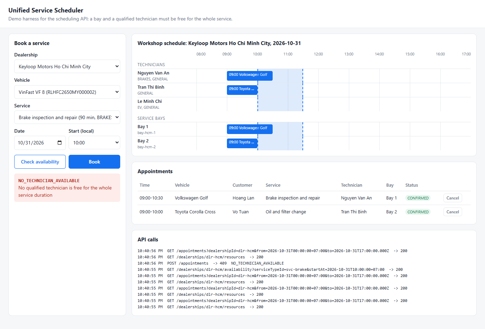

# Unified Service Scheduler
[](https://github.com/LazyBoy311/keyloop-service-scheduler/actions/workflows/ci.yml)

Keyloop technical assessment, **Scenario A (Ownership)**: a backend service that books dealership service appointments. A booking is confirmed only if a **service bay** and a **technician qualified for the job** are both free for the **entire service duration**.

- Video walkthrough (about 7 minutes): https://youtu.be/CJ0EGraJ7Bw
- System design: [`docs/system-design.md`](docs/system-design.md)
- API contract: [`openapi.yaml`](openapi.yaml)
- Production readiness: what is still missing before go-live, and in what order ([design doc, section 8](docs/system-design.md#8-production-readiness))
- Implemented layer: **backend** (REST API + persistent SQL database). The frontend is stubbed by a minimal demo page (below), the OpenAPI contract, the cURL examples and the API test suite.

## Demo UI

`npm start`, then open **http://localhost:3000**. The page is a single static HTML file (`public/index.html`, no framework) served by the API. It lets you:

- check availability and book a service, with the API's error code shown on conflicts;
- see the day's **workshop timeline** per technician and per service bay, with the requested window highlighted, so it is visible *why* a slot was rejected;
- cancel appointments, and watch the raw API calls in a log panel.

The page is covered by Playwright end-to-end tests (`e2e/booking.spec.ts`): book, conflict with its reason, cancel and rebook, bay exhaustion, never-bookable requests, the API log and a phone-width layout. `npm run test:e2e:demo` runs them in a visible, slowed-down browser.



## Quick start

Requirements: **Node.js 22.18+ or 24** (uses the built-in SQLite driver and native TypeScript support, so there is no database to install and no build step).

```bash
npm install
npm test          # 54 tests: business rules, REST API, concurrent booking races, restart
npm run coverage  # 100% line, branch and function coverage of src/
npm run mutation  # breaks 31 pieces of logic one at a time; the tests catch all 31
npm run test:e2e  # 7 Playwright tests of the demo UI in a real browser (first run: npx playwright install chromium)
npm run typecheck # tsc --noEmit
npm start         # http://localhost:3000, data in ./data/scheduler.db
```

Or with Docker (no Node.js needed):

```bash
docker build -t service-scheduler .
docker run -p 3000:3000 -v scheduler-data:/app/data service-scheduler
```

The image uses the same SQLite file, kept in a volume. PostgreSQL is the production path (see the design doc, section 4), not needed to run this submission.

Environment variables: `PORT` (default `3000`), `DB_PATH` (default `data/scheduler.db`, or `:memory:`), `LOG_LEVEL` (default `info`).

Reference data is seeded on start:

| Dealership | Bays | Technicians (skills) |
|---|---|---|
| `dlr-hcm` (UTC+7, 08:00-17:00) | `bay-hcm-1`, `bay-hcm-2` | `tech-an` (GENERAL, BRAKES), `tech-binh` (GENERAL), `tech-chi` (GENERAL, EV) |
| `dlr-hn` (UTC+7, 08:00-17:00) | `bay-hn-1` | `tech-dung` (GENERAL) |

Service types: `svc-oil` 60 min GENERAL, `svc-tyre` 45 min GENERAL, `svc-brake` 90 min BRAKES, `svc-ev` 120 min EV.
Vehicles: `veh-1`, `veh-2` (owner `cus-1`), `veh-3` (owner `cus-2`).

## API walkthrough (cURL)

```bash
# 1. Is a brake job possible at 09:00 local time?
curl "http://localhost:3000/dealerships/dlr-hcm/availability?serviceTypeId=svc-brake&startAt=2030-03-04T09:00:00%2B07:00"
# -> {"available":true,"technicians":[{"id":"tech-an",...}],"serviceBays":[...], ...}

# 2. Book it (Idempotency-Key makes a retry safe)
curl -X POST http://localhost:3000/appointments \
  -H "content-type: application/json" -H "idempotency-key: demo-1" \
  -d '{"dealershipId":"dlr-hcm","vehicleId":"veh-1","serviceTypeId":"svc-brake","startAt":"2030-03-04T09:00:00+07:00"}'
# -> 201 {"id":"...","status":"CONFIRMED","customer":{"id":"cus-1",...},"technician":{"id":"tech-an",...},"serviceBay":{"id":"bay-hcm-1",...}, ...}

# 3. Another brake job overlapping 10:00-11:30: the only BRAKES technician is busy until 10:30
curl -X POST http://localhost:3000/appointments -H "content-type: application/json" \
  -d '{"dealershipId":"dlr-hcm","vehicleId":"veh-2","serviceTypeId":"svc-brake","startAt":"2030-03-04T10:00:00+07:00"}'
# -> 409 {"error":{"code":"NO_TECHNICIAN_AVAILABLE","message":"..."}}

# 4. Read, list, cancel
curl http://localhost:3000/appointments/<id>
curl "http://localhost:3000/appointments?dealershipId=dlr-hcm"
curl -X POST http://localhost:3000/appointments/<id>/cancel

# 5. Operations
curl http://localhost:3000/health
curl http://localhost:3000/metrics
```

### Error codes

| HTTP | Code | Meaning |
|---|---|---|
| 400 | `VALIDATION_ERROR`, `BAD_REQUEST`, `INVALID_START_TIME`, `START_TIME_IN_PAST` | Malformed request, not on the 15-minute grid, or in the past |
| 404 | `DEALERSHIP_NOT_FOUND`, `SERVICE_TYPE_NOT_FOUND`, `VEHICLE_NOT_FOUND`, `APPOINTMENT_NOT_FOUND`, `ROUTE_NOT_FOUND` | Unknown reference or route |
| 409 | `NO_TECHNICIAN_AVAILABLE`, `NO_BAY_AVAILABLE`, `VEHICLE_ALREADY_BOOKED`, `SLOT_TAKEN` | Resources not free for the whole window |
| 422 | `OUTSIDE_OPENING_HOURS`, `NO_QUALIFIED_TECHNICIAN`, `IDEMPOTENCY_KEY_REUSED` | Can never be booked as requested, or a key reused for a different request |

## Project layout

```
src/
  db.ts          schema, overlap triggers, seed data
  scheduler.ts   business rules: time window, availability, atomic booking, cancel
  app.ts         Fastify routes, validation, error mapping, metrics, request id
  server.ts      bootstrap + graceful shutdown
public/index.html  demo UI (test harness for the frontend layer)
test/
  scheduler.test.ts         business rules + multi-connection race (worker threads)
  api.test.ts               HTTP contract via fastify.inject
  http-concurrency.test.ts  two real server processes on one DB, parallel HTTP requests
  server-restart.test.ts    data survives a restart, seeding is idempotent
e2e/booking.spec.ts         Playwright: the demo UI against the real server
scripts/mutation-test.mjs   mutation testing (npm run mutation)
docs/system-design.md
openapi.yaml
```

## How correctness is guaranteed

- **Entire-duration check.** Overlap uses half-open intervals (`a.start < b.end AND a.end > b.start`), so partial overlaps are rejected and back-to-back bookings are allowed.
- **No double booking under concurrency.** Check and insert run in one `BEGIN IMMEDIATE` transaction. In addition, database triggers reject any overlapping confirmed appointment for the same bay, technician or vehicle. A test races three worker threads on separate DB connections for the last slot and asserts exactly one wins. Another starts two real server processes on the same database file and fires parallel HTTP requests at both: the last slot, the bay limit and a retried Idempotency-Key all hold.
- **Safe retries.** `Idempotency-Key` returns the original appointment instead of booking twice. The key is looked up under the same write lock, so retries racing on separate instances are safe too, and reusing a key for a different request is rejected.

## AI Collaboration Narrative

**Tool and roles.** I used Claude Code (an agentic CLI) as the implementer and acted as tech lead: I set the scope and constraints, made the trade-off decisions, and decided when the work was good enough. Almost all of the code was written by the agent. My effort went into directing it and verifying what it produced.

### 1. Strategy for guiding the AI

- **Context before code.** Before asking for anything, I researched Keyloop and used the AI to learn the after-sales domain (service bays, technician skills, why workshop capacity matters), then gave the agent the full challenge brief and that context.
- **Agent drafts end to end, I steer the scope.** My usual workflow is to review the agent's plan and interfaces before any code is written. For this assessment I let it draft a complete first version (schema, domain logic, API, tests, docs) so that I could spend my time reviewing working software rather than a plan. I then steered through explicit decisions:
  - Scenario A and the backend layer.
  - A small demo UI. The first version stopped at cURL examples, and I pushed back because a reviewer should be able to see and try the system.
  - Docker. I asked why there was no Docker or database server, weighed the options, and chose a Dockerfile around SQLite over migrating to PostgreSQL. That keeps the run to one command and leaves PostgreSQL as the documented production path.
  - Small, single-purpose commits, so the history is reviewable.
- **Review depth follows scope.** For a small improvement I check the evidence (tests, output, screenshots) and skim the flow. For the core booking path, the concurrency guarantees and the tests themselves, I review closely and keep questioning the agent until the evidence convinces me.

### 2. Verifying and refining the output

I did not let the agent mark its own homework. Each round of questioning below found real defects:

| What I asked for | What it found |
|---|---|
| **An independent review by a second AI agent** that was given the code but not the first agent's conclusions | 8 issues the implementer missed. The worst: the `Idempotency-Key` lookup ran outside the write lock, so the same retry hitting two instances could fail; a key reused with a different body silently returned someone else's booking; a trigger test never actually exercised the technician trigger. All fixed, each with a test. |
| *"Can we test two API calls at the same time?"* | A test that starts **two real server processes** on one database and fires parallel HTTP requests. It exposed a real bug: Fastify silently drops unknown fields, so a client sending `technicianId` got `201` and believed it had chosen the technician. Unknown fields are now rejected. |
| *"Is there any case we have not tested?"* | 100% line and branch coverage. The `SLOT_TAKEN` path had only been reached when a race happened to interleave that way, so it is now forced with fault injection. |
| *"Are the tests mocking too much?"* | Mutation testing (`npm run mutation`): 31 deliberate bugs, all caught. It also found two weak spots (a booking that ends exactly when another starts; an inclusive `from` filter). The first mutation run reported almost everything caught, which was suspicious: the test command itself was broken, so every mutation looked "caught". The script now runs a baseline first. Verifying the verifier mattered. |
| *"Is this ready for production?"* | An honest "no", turned into the ranked production readiness assessment in the design doc (section 8). |

Other mistakes I caught in the agent's output: it committed the challenge PDF, drew an ER diagram with a table that does not exist, wrote an N+1 query, authored commits with the wrong email, and assumed a `415` response that Fastify does not return. An early draft of this narrative also described a step that never happened, and I removed it.

### 3. Ensuring final quality

- **Tests at every level, all in CI** on Node 22.18 and 24 for every push:
  - 54 backend tests: business rules, the REST contract, worker-thread and two-process races, and restart.
  - 7 Playwright tests of the UI in a real browser.
  - A Docker smoke test.
- **Tests that are proven to test something.** Coverage shows every line runs, and mutation testing shows the assertions fail when the logic is wrong. The Playwright tests were checked the same way, by breaking the UI three ways.
- **Run it like a reviewer.** Fresh clone from GitHub, `npm ci`, the full suite, then a 25-step walkthrough of the API flows over HTTP.
- **Ownership.** I can explain each design decision and its trade-off: auto-assignment, half-open intervals, 409 vs 422, the three layers against double booking, and SQLite now with a PostgreSQL `EXCLUDE` constraint later. I also documented what is deliberately out of scope and why.
