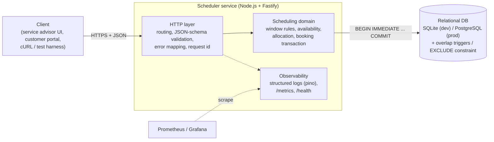
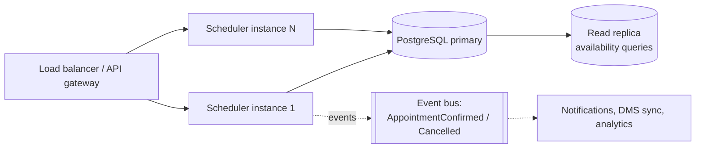
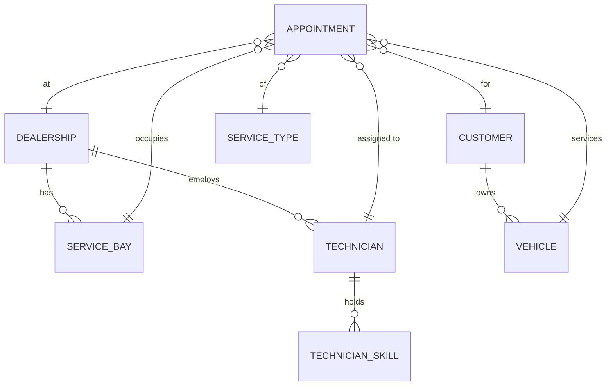
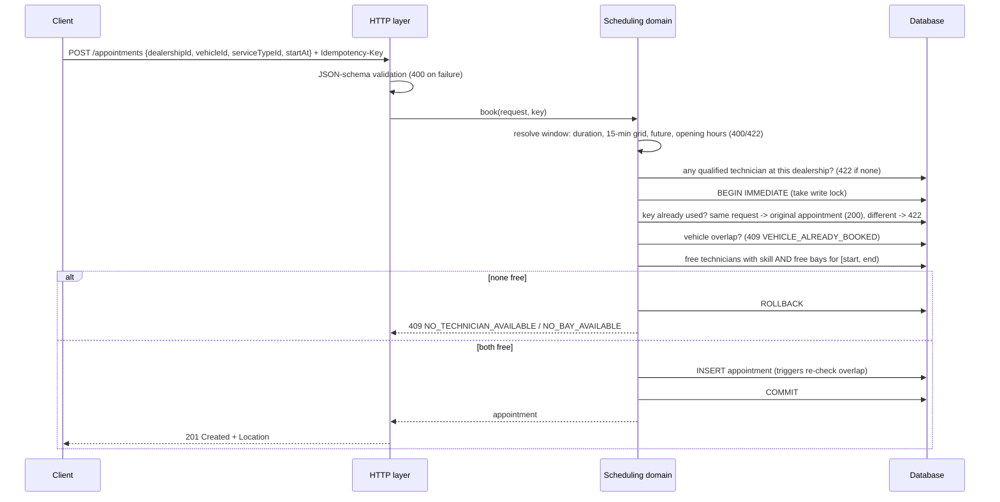

# System Design: Unified Service Scheduler

**Scenario A (Ownership domain).** Replaces manual workshop booking with an API that books a service appointment only when a service bay **and** a qualified technician are free for the whole service duration.

## 1. Problem and scope

After-sales (service, parts, warranty) is the steadiest source of dealership profit, and the workshop's capacity is two scarce resources: **service bays** and **skilled technicians**. Manual booking (phone + spreadsheet) leads to double-booked bays, jobs given to technicians without the right qualification, and idle capacity.

In scope (backend layer, fully implemented):

1. **Resource-constrained booking**: request a service for a vehicle, service type, dealership and start time.
2. **Real-time availability check**: before confirming, check that a bay and a technician holding the required skill are both free for the entire duration.
3. **Confirmed appointment record**: persist an appointment that links customer, vehicle, technician and bay.

Frontend is out of scope as a product, and stubbed by a minimal demo page (`public/index.html`, served at `/`), the OpenAPI contract (`openapi.yaml`), cURL examples in the README and the API test suite.

## 2. Assumptions (requirements were intentionally ambiguous)

| # | Assumption | Why |
|---|---|---|
| A1 | Each **service type** has a fixed duration and one required skill (e.g. Brake inspection = 90 min, `BRAKES`). | Makes "qualified technician" and "entire duration" concrete. |
| A2 | One appointment uses exactly **one bay and one technician** for its whole duration. | Typical for routine service jobs; multi-technician jobs are future work. |
| A3 | The **customer is the vehicle's registered owner**; the client sends `vehicleId`. | Avoids booking a car on behalf of an unrelated customer. |
| A4 | The system **auto-assigns** the technician and bay (first fit). The customer chooses the time, not the person. | Matches how service advisors book; keeps the API simple. |
| A5 | Start times are on a **15-minute grid**, in the future, and the job must **start and finish within opening hours** (08:00-17:00 local). | Reduces calendar fragmentation; jobs do not run overnight. |
| A6 | A **vehicle** cannot have two overlapping appointments (at any dealership). | A car cannot be in two places. |
| A7 | Time intervals are half-open `[start, end)`, so back-to-back bookings are allowed. | Standard interval semantics. |
| A8 | Dealerships use a fixed UTC offset (Vietnam has no DST). | Simplification; IANA time zones are listed as future work. |
| A9 | Reference data (dealerships, bays, technicians, skills, vehicles) comes from the DMS; here it is seeded. | Master-data management is not part of the scenario. |

## 3. Architecture

Target production deployment:

### Components

| Component | Role |
|---|---|
| **HTTP layer** (`src/app.ts`) | Fastify routes, JSON-schema validation of every input, maps domain errors to HTTP status + stable error codes, propagates `x-request-id`, records metrics. |
| **Scheduling domain** (`src/scheduler.ts`) | Pure business rules: validates the time window, finds free qualified technicians and bays, and performs the atomic booking. No HTTP knowledge, so it is unit-tested directly. |
| **Persistence** (`src/db.ts`) | Schema, indexes, overlap triggers and seed data. Uses Node's built-in SQLite driver: zero setup for reviewers. |
| **Server bootstrap** (`src/server.ts`) | Opens the DB, seeds reference data, starts the server, shuts down gracefully. |

### Data model

`service_types.required_skill` must match a `technician_skills.skill` row for the technician to qualify. `appointments` stores `start_at` / `end_at` as UTC epoch ms and a `status` (`CONFIRMED`, `CANCELLED`). Partial indexes on `(bay_id, start_at)`, `(technician_id, start_at)` and `(vehicle_id, start_at)` for confirmed rows keep overlap lookups fast.

## 4. Data flow: booking an appointment

`GET /dealerships/{id}/availability` runs the same validation (including the 422 rules) and resource query without writing, so a UI can show whether a slot is bookable before the user confirms. It reports workshop capacity only; a clash with the same vehicle's other bookings is detected at booking time.

### Correctness under concurrency

The critical race: two advisors book the last free bay at the same moment. Both read "free", both insert, and the bay is double-booked. Three layers prevent it:

1. **Serialised check-then-insert.** The availability query and the insert run inside `BEGIN IMMEDIATE`, which takes the database write lock *before* reading. A second writer waits (`busy_timeout`) and then sees the first booking.
2. **Database invariant.** `BEFORE INSERT` triggers reject any overlapping confirmed appointment for the same bay, technician or vehicle, even if a future code path forgets the check. In PostgreSQL this becomes `EXCLUDE USING gist (bay_id WITH =, tstzrange(start_at, end_at) WITH &&) WHERE (status = 'CONFIRMED')`, which also lets multiple app instances book in parallel without a global lock.
3. **Idempotency keys.** A client that times out and retries does not create a second booking. The key is checked inside the locked transaction, and a key reused with a different body is rejected rather than silently returning someone else's booking.

This is verified by a test that starts three worker threads with **separate database connections** that race for the last slot: exactly one wins.

## 5. Technology choices

| Choice | Justification |
|---|---|
| **TypeScript on Node.js 22+/24** | Type safety for the domain model. Node's native type stripping runs `.ts` directly, so there is no build step. |
| **Fastify** | Built-in JSON-schema validation, structured logging (pino) and `inject()` for fast in-process API tests. |
| **SQLite (built-in `node:sqlite`)** for this submission | Real persistent SQL database with transactions, triggers and partial indexes, and **zero installation** for reviewers. |
| **PostgreSQL** for production | Multi-writer concurrency, `EXCLUDE` constraints on time ranges, read replicas, managed offerings (RDS/Aurora). The SQL and service boundaries are kept portable for this swap. |
| **node:test** | Built into Node: no test framework dependency. |
| **OpenAPI 3.1** | Contract for the stubbed frontend and other consumers. |

Runtime dependencies: **one** (`fastify`).

## 6. Non-functional design

- **Scalability.** The service is stateless, so it scales horizontally behind a load balancer once on PostgreSQL. Booking contention is per dealership, so a future option is to shard or partition by `dealership_id`. Availability reads can go to a replica, or be cached per dealership-day and invalidated on booking events.
- **Performance.** Overlap checks hit partial indexes. Booking is one short transaction.
- **Reliability.** Atomic transactions, DB-level invariants, idempotent `POST` and idempotent cancel. Graceful shutdown on SIGTERM. Stable machine-readable error codes let clients react (e.g. suggest another slot on `NO_BAY_AVAILABLE`).
- **Maintainability.** Domain logic is separate from HTTP. Each business rule has a named test. Assumptions are documented above.

## 7. Observability

| Signal | Implementation now | Production |
|---|---|---|
| **Logs** | Structured JSON (pino), one line per request with `reqId`, status and latency. Domain events are logged: `appointment confirmed` with `appointmentId`, and rejections with their error `code`. | Ship to ELK / CloudWatch / Loki. Alert on spikes of `INTERNAL_ERROR`. |
| **Metrics** | `GET /metrics` in Prometheus format: `http_requests_total` and `http_request_duration_ms_sum` by route and status, `appointments_booked_total`, `appointments_cancelled_total`, `booking_conflicts_total{code}`. | Replace hand-rolled counters with `prom-client` histograms. Dashboards for booking rate, conflict ratio (a capacity-shortage signal for the business) and p95 latency. |
| **Tracing** | `x-request-id` is accepted from callers (or generated), echoed in the response and attached to every log line. | OpenTelemetry auto-instrumentation (HTTP + DB spans), with `traceparent` propagation to downstream DMS / notification services. |
| **Health** | `GET /health` checks the DB connection. | Liveness/readiness probes in Kubernetes. |

A rising `booking_conflicts_total{code="NO_TECHNICIAN_AVAILABLE"}` is also a **business** signal: the dealership needs more technicians with that skill.

## 8. Future work

- Suggest the next available slots when a request conflicts.
- Workload-balanced technician allocation instead of first fit. Bay types (EV lift, alignment bay).
- Technician shifts, leave and breaks. IANA time zones with DST.
- Appointment rescheduling. Outbox pattern publishing `AppointmentConfirmed`/`Cancelled` events.
- AuthN/AuthZ (dealership-scoped roles) and rate limiting.

## 9. How GenAI was used in the design phase

> Draft. Edit this section in your own words before submitting; it must describe your real process.

- **Requirement clarification.** I asked the AI to list ambiguities in the three core requirements. That produced the assumptions table (duration per service type, one bay plus one technician, customer = vehicle owner, opening hours, half-open intervals). I then decided which ones to adopt.
- **Risk identification.** I prompted for "what breaks a scheduling system in production". The AI flagged the check-then-insert race condition. I chose a defence-in-depth answer (transaction lock + DB constraint + idempotency) rather than only an application-level check.
- **Technology trade-offs.** I compared PostgreSQL vs. SQLite with the AI. Because Docker was not available locally and reviewers should be able to run the project with one command, we chose SQLite for the submission. I kept the PostgreSQL `EXCLUDE` constraint as the documented production path.
- **Diagrams.** The AI drafted the Mermaid diagrams from the agreed component list. I reviewed them against the code.
